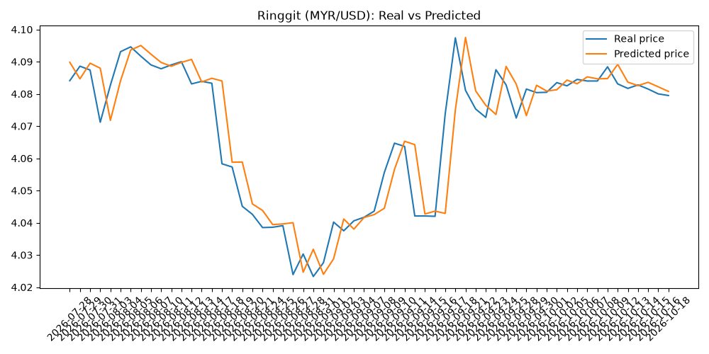

# ringgit-predictor

my first ML project. it tries to predict tomorrow's USD/MYR rate using the previous 3 trading days.

the model is just linear regression. 

## what it does

pulls USD/MYR data going back to 2015 from Yahoo Finance, then takes the closing prices from the previous 3 days and uses them to predict the next one.

so basically this:

```text
3 days ago ─┐
2 days ago ─┼─> linear regression ─> tomorrow
1 day ago  ─┘
```

I trained it on everything except the latest 60 trading days. Those 60 days were kept aside to see how it does on data it hasn't seen before.

got an MAE of around **0.006 MYR**.

which basically means the predictions were off from the real rate by around RM 0.006  on average during those 60 days.



## stuff i learned

### yfinance

never used this before.

turns out getting actual market data in python is just:

```python
data = yf.download("USDMYR=X", start="2015-01-01")
```

then:

```python
data.to_csv("ringgit_history.csv")
```

to save it.


### pandas

this I think is the biggest takeaway from today's learning sesh.

some syntax i used:

```python
pd.read_csv()
df[["Date", "Close"]]
df.dropna()
df["Close"].astype(float)
df.iloc[]
```

the main new thing was `shift()`.

```python
df["lag1"] = df["Close"].shift(1)
df["lag2"] = df["Close"].shift(2)
df["lag3"] = df["Close"].shift(3)
```

this is how to give the model the previous 3 days.

also finally getting what stuff like this means:

```python
train = df.iloc[:-60]
test = df.iloc[-60:]
```

first one = everything except the last 60 rows.

second one = the last 60 rows.

i still wouldn't trust myself to remember all the pandas syntax without looking them up tho.

### scikit-learn

this part I think was surprisingly simple:

```python
model = LinearRegression()
model.fit(X_train, y_train)
predictions = model.predict(X_test)
```

create the model -> give it the training data -> then make it predict data it hasn't seen.

also used:

```python
mean_absolute_error(y_test, predictions)
```

to see how wrong the predictions were on avrage.

### matplotlib

I used matplotlib to make the real vs predicted graph.

first time properly using this too.

```python
plt.plot()
plt.legend()
plt.title()
plt.savefig()
```

## ML stuff that actually clicked

**features vs target**

the features are the information i'm giving the model:

```text
lag1, lag2, lag3
```

the target is what i'm asking it to predict:

```text
the next closing price
```

**supervised learning**

i'm giving the model past examples where the correct answer is already known, and it learns from those.

**time series can't just be randomly split**

this one made sense once i actually used real data.

if i'm trying to predict the future using the past, randomly mixing dates between training and testing would be weird.

so i trained on the older data and tested on the newest 60 days.

**overfitting**

doing well on the data the model trained on doesn't really prove anything.

that's why i kept the last 60 days completely out of training.

**MAE**

mean absolute error.

basically just:

> how wrong am i on average?

for this run, around 0.006 MYR.

## to run it

```bash
pip install yfinance pandas scikit-learn matplotlib
python fetch_data.py
python build_features.py
```
 
**project 1.**

## note to self

the ML ideas weren't really the hard part today, the Python was.

I can read through the code now and explain what it's doing, but I definitely couldn't open a blank file and write all of this again from memory.

especially the pandas stuff. shift(), iloc, selecting columns, cleaning the dataframe. I understand them when I see them, but they're not in my fingers yet.

also worth being honest: AI wrote a lot of the code for this first version. I mostly worked through it line by line until I understood what was happening.
