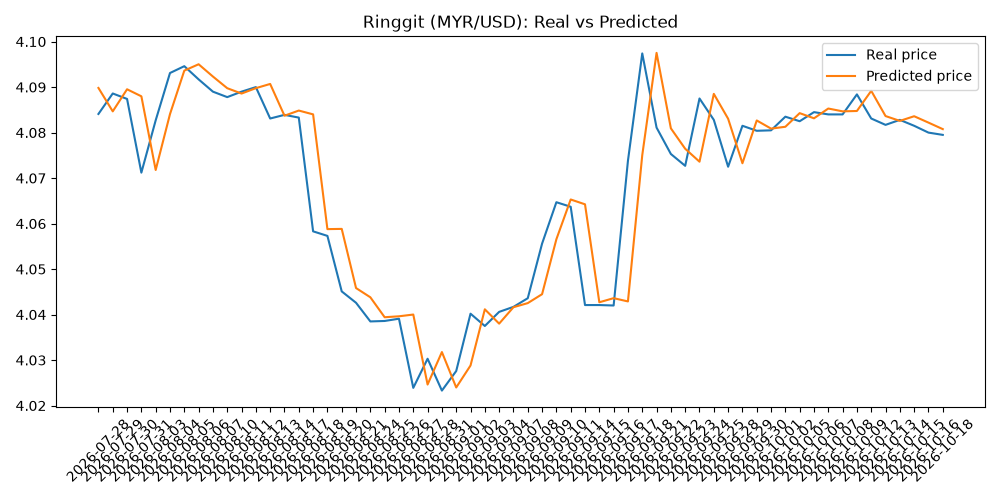

# Ringgit Predictor

This is my first machine learning project. It tries to predict tomorrow's US dollar to Malaysian ringgit exchange rate using the closing prices from the previous three trading days. The model is a simple linear regression.

Built with Python, pandas, scikit-learn, matplotlib and yfinance.

## What I found

I trained the model on about 3,000 trading days of data going back to 2015. I kept the most recent 60 trading days completely separate so I could test the model on data it had never seen.

The model's average error on those 60 days was about RM 0.0060. At first that looked very good.

Then I compared it with the simplest guess possible, which is that tomorrow's rate will be the same as today's. That guess had an average error of about RM 0.0059, so it did slightly better than my model.

| Method | Average error on the 60 test days |
|---|---|
| My linear regression model | RM 0.0060 |
| Simple guess (tomorrow will be the same as today) | RM 0.0059 |

When I looked at the model's weights, the reason was clear. It put almost all of its weight on yesterday's price and almost none on the other two days. In other words, the model had mostly learned to copy yesterday's rate.

This was the most useful thing I learned from the project. A low error does not mean a model has learned anything useful. You need to compare it against a simple baseline before you can say it works. It also showed me how hard it is to predict exchange rates from past prices alone.



## How it works

The script `fetch_data.py` downloads daily USD/MYR prices from Yahoo Finance and saves them to a CSV file.

The script `build_features.py` does the rest. It creates three features from the previous three days' closing prices, splits the data by date so that the test set is always the most recent period, trains the model, compares it with the simple baseline, and saves the chart above.

To run it yourself:

```bash
pip install -r requirements.txt
python fetch_data.py
python build_features.py
```

## What I would try next

The model can get away with copying yesterday because it predicts the rate itself. Next, I want to predict the daily change in the rate instead, so copying is no longer an option. I would also like to add other information that affects the ringgit, such as oil prices and interest rates, and test the model over several time periods instead of just one.

## What I learned along the way

This was my first time using most of these tools, so I kept notes as I went.

**Getting the data.** I had never used yfinance before. It turns out that downloading real market data in Python takes only a couple of lines.

```python
data = yf.download("USDMYR=X", start="2015-01-01")
data.to_csv("ringgit_history.csv")
```

**pandas.** This was the biggest thing I learned. The most important new idea was `shift()`, which is how I gave the model the previous three days.

```python
df["lag1"] = df["Close"].shift(1)
df["lag2"] = df["Close"].shift(2)
df["lag3"] = df["Close"].shift(3)
```

I also finally understood how to split the data with `iloc`. The first line below takes everything except the last 60 rows for training, and the second takes the last 60 rows for testing.

```python
train = df.iloc[:-60]
test = df.iloc[-60:]
```

**scikit-learn.** This part was simpler than I expected. You create the model, train it on the data, and then ask it to predict data it has not seen.

```python
model = LinearRegression()
model.fit(X_train, y_train)
predictions = model.predict(X_test)
```

**matplotlib.** I used it for the first time to draw the chart comparing the real and predicted rates.

**Machine learning ideas that clicked.** The features are the information I give the model, and the target is what I ask it to predict. Supervised learning means the model learns from past examples where the right answer is already known. Time series data cannot be split randomly, because then the model would be trained on the future and tested on the past. Doing well on training data proves nothing, which is why the last 60 days stayed out of training. Mean absolute error simply tells you how wrong you are on average. And a model is only useful if it beats the simplest possible guess.

## An honest note

The machine learning ideas were not the hardest part. The Python was. I can read through this code and explain what every line does, but I could not yet write all of it from a blank file. AI helped me write a lot of the code for this first version, and I worked through it line by line until I understood it. My goal for the next project is to write more of it myself.
